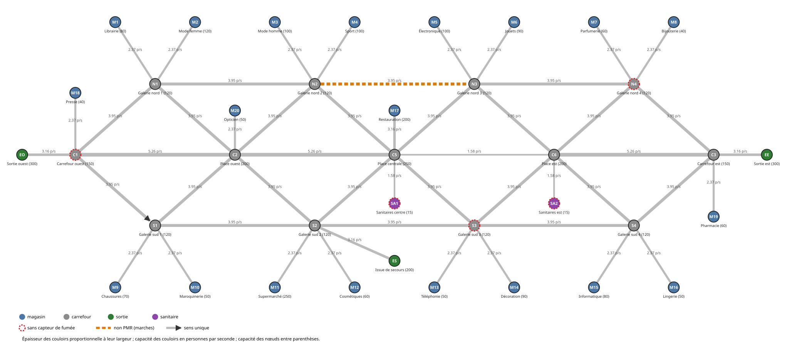

# Plan proposé pour le centre détaillé A



Centre de plain-pied d'environ 80 m × 40 m : une allée principale est–ouest, une galerie au nord et une galerie au sud. Les données sont dans `donnees/centres/A.json` ; la figure se régénère avec :

```bash
python rapport/dessiner_plan.py donnees/centres/A.json rapport/figures/plan_A.svg
```

**C'est une proposition, à redessiner et à ajuster par le binôme.** Après toute modification du JSON, relancer `pytest tests/test_plan_A.py` : il vérifie que le plan contient toujours chacun des cas ci-dessous.

## Les cas couverts (PLAN.md § 6)

| Cas demandé | Où dans le plan |
|---|---|
| 2 sorties sur des côtés opposés | `EO` à l'ouest, `EE` à l'est |
| Au moins 6 magasins et 1 sanitaire | `M1` à `M8`, sanitaires `SA` |
| Un cycle, donc des chemins alternatifs | `C1 – C2 – N – C1`, et la boucle par la galerie sud |
| Un goulot sur un passage fréquenté | `C2 – C3` : 1,2 m de large (un kiosque rétrécit l'allée), sur le plus court chemin entre les deux sorties |
| Une arête non PMR, contournable | `N – C3` : marches. Un fauteuil passe par `N – C2 – C3` (42 m au lieu de 31,3 m) |
| Une arête à sens unique | `C1 → S` : on entre dans la galerie sud par l'ouest seulement |
| 2 nœuds sans capteur, dont un sur un chemin d'évacuation | `C1`, `S` et `SA`. `C1` est sur le chemin des magasins de l'ouest vers la sortie `EO` |
| Un feu possible près d'une sortie | `M4` (électronique) est à deux couloirs de la sortie `EE` |

## Dimensions

- **Longueur** d'un couloir : distance entre ses deux extrémités sur le plan.
- **Capacité** d'un couloir : sa largeur × 1,316 personnes par mètre et par seconde (débit maximal SFPE, voir `sources.md`). Largeurs : 4 m pour l'allée principale, 3 m pour les galeries, 2,4 m pour les portes de sortie, 1,8 m pour les entrées de magasin, 1,2 m pour le goulot et l'accès aux sanitaires.
- **Capacité** d'un nœud : hypothèse de dimensionnement, de 15 personnes (sanitaires) à 300 (sorties), selon la taille du lieu. À justifier ou ajuster dans le rapport.
